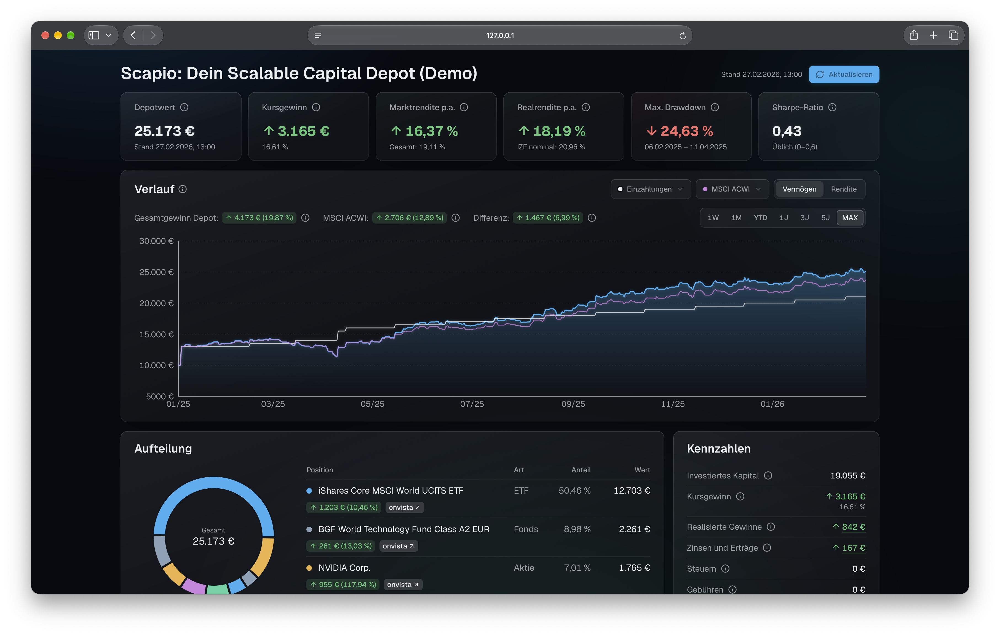

# Scapio: Privates Dashboard für dein Depot bei Scalable Capital (Community-Project)

&nbsp;&nbsp;&nbsp;&nbsp;&nbsp;&nbsp;&nbsp;&nbsp;

**[Live-Demo ansehen](https://scapio-demo.falling-bonus-5fff.workers.dev)** — mit erfundenem Depot, ohne Anmeldung.

> [!IMPORTANT]
> Scapio ist ein Community-Projekt und kein offizielles Produkt von Scalable Capital!

## ✅ Funktionen

- **Rendite:** deine persönliche Rendite (IZF, interner Zinsfuß) auch nach Abzug der Inflation. So weißt du, was real übrig bleibt.
- **Benchmark:** dein Depot (TWR, Time-Weighted Return) im Vergleich zu MSCI World, MSCI ACWI, Gold, Bitcoin und dem risikofreien Zins. So siehst du, ob sich deine Strategie lohnt.
- **Risiko:** Volatilität*, maximaler Drawdown und Sharpe-Ratio*. So erkennst du, wie stark dein Depot schwankt und ob sich das Risiko auszahlt. 
- **Top 25 (optional):** die Unternehmen, in die du über alle ETFs hinweg wirklich investiert bist. So erkennst du Klumpenrisiken. Standardmäßig aus, siehe [Top 25 einschalten](#-top-25-einschalten).
- **Erträge & Steuern:** realisierte Gewinne, Zinsen, Ausschüttungen und Steuern einzeln aufgeschlüsselt.
- **Sparen:** Käufe, Verkäufe und aktive Sparpläne. So siehst du, wie viel du monatlich investierst.

**Volatilität und Sharpe-Ratio erscheinen erst, wenn dein Depot mindestens 13 Monate alt ist. Vorher gibt es zu wenige Monatsrenditen für eine belastbare Aussage.*

## 🔒 Sicherheit

Deine Daten bleiben sicher: Scapio läuft lokal auf deinem Computer (ohne Cloud) und liest nur Daten ohne etwas zu ändern oder zu handeln. Scapio nutzt die offizielle Anmeldung und MCP-Schnittstelle von Scalable Capital und speichert keine Zugangsdaten.

> [!TIP]
> Stelle die Zugriffsstufe des MCP bei Scalable auf „Leserechte“ – dann ist jede Änderung zusätzlich auf Seiten der Bank ausgeschlossen.

Auf einem Windows-Rechner mit mehreren Benutzerkonten sind die lokalen Daten weniger streng geschützt als unter macOS – Details in [docs/SICHERHEIT.md](docs/SICHERHEIT.md).

## ⬇️ Installation

Du brauchst einen Mac oder Windows-PC, Zugang zu deinem Scalable-Depot und etwa 10-15 Minuten.

1. **"Agentic Investing" bei Scalable aktivieren:** Im Scalable-Konto den **[MCP-Zugriff aktivieren](https://de.scalable.capital/agentic-investing)** (die Schnittstelle für KI-Assistenten) und als Zugriffsstufe „Leserechte“ wählen.
2. **Node.js installieren**, falls noch nicht vorhanden. Auf **[nodejs.org/de/download](https://nodejs.org/de/download)** den Installer für dein System laden, öffnen und mit „Weiter“ bzw. „Fortfahren“ durchklicken.
3. **[Scapio als ZIP herunterladen](https://github.com/jx42/Scapio/releases/latest/download/Scapio.zip)** und entpacken:
  - **macOS:** Safari entpackt das ZIP meist selbst. Den Ordner `Scapio` aus „Downloads“ an einen festen Ort ziehen, z. B. in deinen Benutzerordner (im Finder: „Gehe zu“ → „Benutzerordner“).
  - **Windows:** Rechtsklick auf das ZIP → „Alle extrahieren…“. Nicht die Dateien direkt in der ZIP-Ansicht doppelklicken, das funktioniert nicht.
4. **Im entpackten Ordner doppelklicken:** [Start.command](Start.command) (macOS) bzw. [Start.bat](Start.bat) (Windows). Beim ersten Mal erscheint eine Sicherheitswarnung, siehe unten.
5. Es öffnet sich unter macOS das **Terminal**, unter Windows die **Eingabeaufforderung** (unter Windows 11 ebenfalls „Terminal“ genannt). Lass es offen, solange du Scapio benutzt, denn darin läuft Scapio. Beim ersten Start dauert die Einrichtung einige Minuten.
6. Im Browser öffnet sich die Anmeldung von Scalable. Mit deinem gewohnten **Scalable-Capital-Login** anmelden und in der App bestätigen.

Das war's. Scapio holt deine Depotdaten und öffnet sich danach im Browser. Ab jetzt genügt ein Doppelklick auf Start.

> [!TIP]
> **Warnung beim ersten Start?** Die Startdateien sind nicht signiert, deshalb fragt das System einmal nach.
> - **macOS 15 (Sequoia) und neuer:** Die Meldung, dass die Datei nicht geöffnet wurde, mit „Fertig“ schließen. Dann **Systemeinstellungen → Datenschutz & Sicherheit** öffnen, nach unten scrollen und bei „Start.command wurde blockiert“ auf **„Dennoch öffnen“** klicken, mit Passwort oder Touch ID bestätigen.
> - **macOS 14 und älter:** Rechtsklick auf die Datei → „Öffnen“ → „Öffnen“.
> - **Windows** meldet „Der Computer wurde durch Windows geschützt“: „Weitere Informationen“ → „Trotzdem ausführen“.

**Alternative: Installation mit Git** (für Fortgeschrittene, Updates dann per Doppelklick)

Mit Git ist jedes spätere Update ein Doppelklick auf `Aktualisieren.command` bzw. `Aktualisieren.bat`, statt ein neues ZIP zu laden. Dafür braucht es einmal das Terminal:

1. [Git installieren](https://git-scm.com/downloads), falls noch nicht vorhanden. Unter macOS genügt es, im Terminal `git --version` einzugeben; fehlt Git, bietet macOS die Installation selbst an.
2. Im Terminal `git clone https://github.com/jx42/Scapio.git` eingeben. Der Ordner `Scapio` liegt danach in deinem Benutzerordner.
3. Weiter mit Schritt 4 oben. Eine Sicherheitswarnung erscheint bei diesem Weg nicht.

## 💻 Wo liegen meine Daten?

Datenbank, Sicherungen, Cache und Anmeldung liegen dort, wo das Betriebssystem Anwendungsdaten erwartet und überstehen jedes Update. Details in [docs/SICHERHEIT.md](docs/SICHERHEIT.md).

| Betriebssystem | Ort                                     | So öffnest du ihn                                               |
| -------------- | --------------------------------------- | --------------------------------------------------------------- |
| macOS          | `~/Library/Application Support/scapio/` | Im Finder ⇧⌘G drücken („Gehe zu Ordner“), Pfad einfügen, Enter. |
| Windows        | `%LOCALAPPDATA%\scapio\`                | Windows-Taste + R drücken („Ausführen“), Pfad einfügen, Enter.  |

## 🏢 Top 25 einschalten

Die Kachel „Top 25 Unternehmen“ listet die 25 Unternehmen, in die du das meiste Geld investiert hast – über alle ETFs und Aktien zusammengerechnet. Sie ist standardmäßig deaktiviert, weil sie nur mit ETFs von iShares, Xtrackers und Amundi funktioniert und dafür deren inoffizielle Schnittstellen abfragt. Ist sie deaktiviert, fragt Scapio diese Anbieter gar nicht erst ab. Ist sie aktiviert, erfahren die Anbieter mit jedem Abruf, welche ihrer ETFs du hältst (nicht wie viel). Um die Kachel zu aktivieren:

1. Die Datei `docs/einstellungen.example.json` aus dem Scapio-Ordner in den Datenordner kopieren (siehe [Wo liegen meine Daten?](#-wo-liegen-meine-daten)) und in `einstellungen.json` umbenennen. Liegt dort schon eine `einstellungen.json`, stattdessen die Zeile `"top25": true` in sie übernehmen.
2. Scapio neu starten und auf „Aktualisieren“ klicken.

ETFs von Xtrackers und Amundi erkennt Scapio selbst. Fehlen iShares-Fonds, nennt die Kachel sie und erklärt, wie du sie in einer `funds.json` einträgst. Ausschalten: in `einstellungen.json` `true` durch `false` ersetzen und neu starten.

## ⏹️ Beenden

Terminal (macOS) bzw. Eingabeaufforderung (Windows) schließen beendet Scapio. macOS fragt dabei, ob der laufende Prozess beendet werden soll: mit „Beenden“ bestätigen. Nach einem Neustart des Rechners läuft nichts weiter.

## 🔄 Aktualisieren

Depotdaten, Sicherungen, Anmeldung, eigene Fondsliste und Einstellungen liegen außerhalb des Scapio-Ordners und bleiben bei jedem Update erhalten.

Was sich in einer Version geändert hat, steht unter [Releases](https://github.com/jx42/Scapio/releases).

**Als ZIP installiert:**

1. Dashboard schließen.
2. [Aktualisieren.command](Aktualisieren.command) (macOS) bzw. [Aktualisieren.bat](Aktualisieren.bat) (Windows) doppelklicken. Der Browser lädt das neue ZIP herunter (oder direkt: [neues ZIP herunterladen](https://github.com/jx42/Scapio/releases/latest/download/Scapio.zip)).
3. Das ZIP entpacken, den alten Ordner löschen und den neuen an seine Stelle legen.
4. Im neuen Ordner [Start.command](Start.command) (macOS) bzw. [Start.bat](Start.bat) (Windows) doppelklicken. Die Sicherheitswarnung aus der Installation erscheint dabei erneut.

> [!TIP]
> **Windows:** Vor dem Entpacken Rechtsklick auf das ZIP → „Eigenschaften“ → unten „Zulassen“ anhaken → „OK“. Dann fragt Windows beim Start nicht erneut nach.

**Mit Git installiert:** Dashboard schließen, dann [Aktualisieren.command](Aktualisieren.command) (macOS) bzw. [Aktualisieren.bat](Aktualisieren.bat) (Windows) doppelklicken. Scapio startet danach von selbst neu, eigene Einstellungen bleiben erhalten.

Wer auch das Entpacken sparen will, steigt einmal auf die Installation mit Git um (unter „Installation“ → „Alternative: Installation mit Git“).

## 🗑️ Deinstallieren

1. Scapio beenden (Terminal bzw. Eingabeaufforderung schließen).
2. [Deinstallieren.command](Deinstallieren.command) (macOS) bzw. [Deinstallieren.bat](Deinstallieren.bat) (Windows) doppelklicken. Das Skript löscht den Datenordner mit Datenbank, Sicherungen, Einstellungen und der Anmeldung bei Scalable. Vorher bietet es eine letzte Sicherung nach `~/Scapio-Sicherung/` an und verlangt zur Bestätigung die Eingabe `ENTFERNEN`.
3. Das Fenster schließen und den Scapio-Ordner löschen.
4. Optional: Im Scalable-Konto den MCP-Zugriff wieder deaktivieren.
5. Optional: Node.js entfernen, wenn du es nur für Scapio installiert hast. Unter Windows über Einstellungen → Apps. Unter macOS darf es bleiben, es läuft nicht im Hintergrund.

Ohne das Skript: den Datenordner von Hand löschen (siehe [Wo liegen meine Daten?](#-wo-liegen-meine-daten)). Findet das Skript dort Dateien, die nicht von Scapio stammen, löscht es nichts und verweist auf diesen Weg.

## 📊 Datenquellen

| Quelle                                                                                                                                                                                                    | Wofür                                                                         | Bedingungen                                                           |
| --------------------------------------------------------------------------------------------------------------------------------------------------------------------------------------------------------- | ----------------------------------------------------------------------------- | --------------------------------------------------------------------- |
| Scalable Capital, offizielle MCP-Schnittstelle                                                                                                                                                            | Dein Depot: Positionen, Transaktionen, Sparpläne; Kurshistorie der Benchmarks | dein eigener, ausschließlich lesender Zugriff auf deine eigenen Daten |
| Eurostat, harmonisierter Verbraucherpreisindex ([`prc_hicp_midx`](https://ec.europa.eu/eurostat/databrowser/view/prc_hicp_midx), [`ei_cphi_m`](https://ec.europa.eu/eurostat/databrowser/view/ei_cphi_m)) | Inflation für die Realrendite                                                 | © Europäische Union; Weiterverwendung mit Quellenangabe erlaubt       |
| Europäische Zentralbank, [€STR (`EST`)](https://data.ecb.europa.eu/data/datasets/EST)                                                                                                                     | Risikofreier Zins für die Sharpe-Ratio und als Benchmark                      | Weiterverwendung mit Quellenangabe erlaubt                            |
| iShares, DWS Xtrackers, Amundi                                                                                                                                                                            | Bestandslisten der ETFs, nur mit eingeschalteter Top-25-Ansicht               | Nutzungsbedingungen des jeweiligen Anbieters                          |

Die Schnittstellen von iShares, Xtrackers und Amundi sind nicht offiziell dokumentiert und können sich jederzeit ändern. Fehlt die Top-25-Ansicht nach einem Update eines Anbieters, liegt das meist dort und nicht an deinem Depot.

Je weiter die Kurshistorie von Scalable Capital zurückreicht, desto gröber ist sie: Für Zeiträume älter als etwa ein Jahr liefert die Schnittstelle nur monatliche Kurse, näher an heute zweitäglich bis täglich. Eine als auffällig markierte Kursbewegung in älteren Daten ist deshalb oft eine normale Bewegung über mehrere Wochen, kein echter Tagessprung.

## ⚠️ Haftungsausschluss

- **Scapio ist ein unabhängiges Community-Projekt. Es ist kein offizielles Produkt der Scalable Capital GmbH und wird von ihr weder betrieben noch unterstützt oder empfohlen.** Dasselbe gilt für BlackRock (iShares), DWS (Xtrackers), Amundi und MSCI. Alle genannten Namen sind Marken ihrer Inhaber und werden hier nur genannt, um zu beschreiben, mit welchem Depot und welchen Datenquellen Scapio zusammenarbeitet.
- **Scapio zeigt Kennzahlen zu Informationszwecken.** Es ist keine Anlageberatung, keine Steuerberatung und keine Empfehlung zum Kauf oder Verkauf eines Wertpapiers.
- **Maßgeblich sind allein die Abrechnungen und Steuerbescheinigungen deiner Bank**. Alle Zahlen werden aus den Rohdaten der Bank neu berechnet und können von deren Abrechnungen abweichen, besonders bei Steuern, Teilfreistellung und Vorabpauschale.
- **Die Software wird ohne Gewähr bereitgestellt,** die Nutzung erfolgt auf eigenes Risiko; Einzelheiten in der [Lizenz](LICENSE).
- **Scapio ist auf ein typisches Weltportfolio ausgelegt:** ETFs und Aktien, gekauft per Einmalkauf oder Sparplan. Andere Depots – etwa mit Anleihen, Bruchstücken oder Depotüberträgen ohne Gegenstück – sind ungetestet und funktionieren womöglich nicht richtig. Fehlermeldungen und Pull Requests sind willkommen, eine Zusage auf Unterstützung gibt es nicht.

## 🛠️ Entwicklung

Kommandozeile, Befehle, Tests und Aufbau des Projekts: [docs/ENTWICKLUNG.md](docs/ENTWICKLUNG.md).

Die Schrift [Geist](https://github.com/vercel/geist-font) steht unter der [SIL Open Font License 1.1](https://openfontlicense.org) und wird mit Scapio ausgeliefert.
